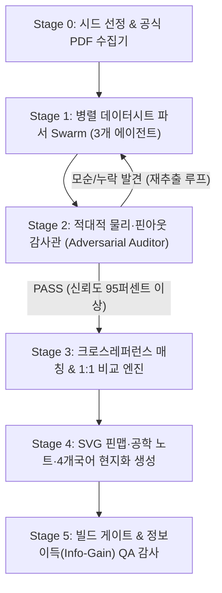

# 02. Token Burn Pipeline — 20배 Ultra 요금제 멀티에이전트 아키텍처

## 1. 파이프라인 핵심 철학

20배 Ultra 요금제의 대규모 토큰을 **1회성 초안 작성**에 낭비하지 않고, **5단계 적대적 멀티에이전트 검증 공장(5-Stage Adversarial Verification Factory)**에 투입한다.

하나의 부품(Golden Part Record)과 연관 비교 페이지를 완성하는 데 **평균 25만–40만 토큰**을 의도적으로 소모하여, 할루시네이션율 0.5퍼센트 미만의 산업급 DB를 구축한다.

---

## 2. 5단계 멀티에이전트 파이프라인 구조

### Stage 0: 공식 데이터시트 & 메타 수집기
- 부품명(MPN), 제조사, 카테고리, 공식 PDF 링크 또는 로컬 PDF 텍스트/테이블 추출본을 큐(Queue)에 적재한다.
- Python(`pymupdf` / `pdfplumber`)으로 PDF 텍스트와 표를 페이지 번호 태깅(`[PAGE 4]`)하여 청킹한다.

### Stage 1: 3분할 전문 파서 스웜 (병렬 실행 · 고토큰 구간 1)
데이터시트 전체를 1개 프롬프트에 대충 넣지 않고, 3명의 전문 에이전트가 독립적으로 정밀 추출한다.

1. **Agent A (Electrical Spec Extractor)** – 절대최대정격, 권장 동작 조건, 전기적 특성(Min/Typ/Max 및 측정 조건 $T_A$, $V_{IN}$, $I_{OUT}$), 원문 페이지 번호 추출.
2. **Agent B (Package & Pinout Extractor)** – 모든 패키지 옵션(SOT-23-3, SOT-23-5, SOIC-8 등), 각 패키지별 핀 번호·핀 이름·기능(IN/OUT/GND/EN/FB/NC) 매핑, 열저항($\theta_{JA}$, $\theta_{JC}$) 추출.
3. **Agent C (Application & Gotcha Extractor)** – 권장 입출력 커패시터 용량 및 ESR 범위, 세라믹 캡 안정성 여부, 피드백 기준전압($V_{REF}$), 보호기능(UVLO, OCP, OTP), 실제 설계 함정 추출.

### Stage 2: 적대적 감사 에이전트 (Adversarial Auditor · 고토큰 구간 2)
가장 중요한 토큰 소모 구간으로, Stage 1 결과물을 **틀렸다고 가정하고 원문 PDF 청크와 1:1 대조 공격**한다.

1. **단위·자릿수 교차검사** – `μA` vs `mA`, `mV` vs `V`, `Ω` vs `kΩ` 오인식 여부를 원문 표와 재검증한다.
2. **물리 법칙 일관성 검사** – 예를 들어 `V_in_max(abs) >= V_in_max(rec)`, `V_out < V_in_max`, LDO의 `Dropout + V_out <= V_in_min` 조건, 핀 개수와 패키지 명칭 일치(SOT-23-5는 정확히 5핀) 여부를 코드 + LLM 이중 검증한다.
3. **재시도 루프** – 단 1건이라도 근거 페이지 번호가 없거나 불일치하면 최대 3회 재파싱하며, 끝내 불확실한 필드는 임의 추측 대신 `null` 및 `needs_human_review: true`로 격리한다.

### Stage 3: 크로스레퍼런스 매칭 & 1:1 비교 분석기 (고토큰 구간 3)
동일 카테고리 내 부품들(예: 3.3 V LDO 100종)에 대해 결정론적 스코어링과 LLM 엔지니어링 심층 비교를 결합한다.

1. **1차 결정론적 필터** – 패키지, 전압 범위, 전류 정격, 핀아웃 매핑 테이블을 TypeScript/Python 알고리즘으로 전수 매칭해 상위 후보 10종을 추린다.
2. **2차 LLM 엔지니어링 리뷰** – 후보 10종 중 상위 5쌍에 대해 **"실제 PCB에서 A를 떼고 B를 붙였을 때 생길 수 있는 문제"**(핀 순서, 기동 시퀀스, EN 풀업 유무, 세라믹 캡 발진, 열여유 감소)를 구체적으로 서술하고 호환 등급(`Level 1 / 2 / 3`)을 판정한다.

### Stage 4: SVG 핀맵 코드 생성 & 4개국어 기술 현지화 (고토큰 구간 4)
- **표준 패키지 SVG 템플릿 엔진** – LLM이 임의로 좌표를 그려 망가뜨리지 않도록 결정론적 SVG 패키지 렌더러(SOT-23-3/5/6, SOIC-8/14/16, TSSOP, QFN)에 Stage 2 검증 완료 핀맵 JSON을 바인딩한다.
- **4개국어 기술 문서 생성 (EN / KO / JA / DE)** – 단순 직역이 아니라 각 언어권 전자공학 실무 용어(예: 일본어 静止電流·ドロップアウト電圧, 독일어 Ruhestrom·Sperrschichttemperatur, 한국어 대기전류·드롭아웃 전압)로 자연스럽게 현지화한다.

### Stage 5: 최종 빌드 게이트 & 정보이득 QA 감사
- **Thin Content 차단** – 고유 스펙 필드 12개 미만, 원문 PDF 페이지 인용 누락, 비교 대상 간 차별 분석 부실 페이지는 자동으로 빌드에서 제외한다.
- **링크·렌더링 검사** – 빌드된 HTML에서 깨진 링크, `NaN`/`undefined`, 빈 표, 메타 태그 누락을 전수 검증한다.

---

## 3. 예상 토큰 소모량 시뮬레이션 (20배 요금제 활용도)

| 작업 단위 | 건수 (1차 목표) | 건당 평균 토큰(입력+출력) | 총 소모 토큰 |
| :--- | :--- | :--- | :--- |
| 부품 PDF 3분할 파싱 + 적대적 감사 | 500종 | 약 220,000 토큰 | 약 1.1억 토큰 |
| 1:1 정밀 비교 (`vs`) 엔지니어링 분석 | 1,500쌍 | 약 45,000 토큰 | 약 6,750만 토큰 |
| 대체품 허브 (`alt`) 종합 큐레이션 | 500종 | 약 40,000 토큰 | 약 2,000만 토큰 |
| 4개국어(EN/KO/JA/DE) 기술 현지화 + QA | 2,500페이지 × 4 | 약 15,000 토큰/로케일 | 약 1.5억 토큰 |
| **합계 (1차 마일스톤 기준)** | **총 10,000 SSG 페이지** | — | **약 3.5억 토큰** |

> 1차 500종 완료 후 2차 2,000종으로 확장 시 **10억 토큰 이상**을 온전히 고품질 DB 해자 구축에 소모할 수 있다.
