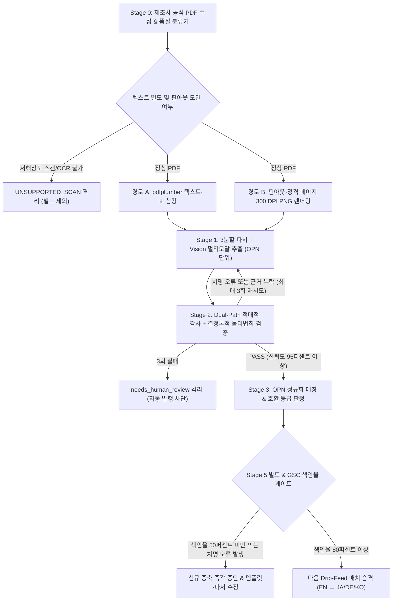

# 05. Risk, Cross-Audit & KPI Execution Plan — Pin2Pin Global

> **감사 대상**: `README.md`, `01-MASTER-PLAN.md`, `02-TOKEN-BURN-PIPELINE.md`, `03-DATA-SCHEMA-AND-SEED.md`, `04-MONETIZATION-AND-SEO.md` (총 5종)  
> **감사 목적**: Phase 1 착수 전 치명적 기술·법적·재무·SEO 결함을 선제 차단하고, 현실적 수익 시뮬레이션·Kill/Pivot 기준선·Day 1–7 즉시 실행 체크리스트를 확정한다.

---

## 1. 기존 기획서 5종 정밀 교차감사 결과

기존 기획서는 **"20배 Ultra 요금제 토큰을 적대적 팩트체크와 엔지니어링 DB 구축에 투입한다"**는 전략적 방향이 매우 탁월하다. 그러나 실제 구현과 수익화 단계로 넘어가기 전 반드시 수정해야 할 **치명적 취약점 6건**과 **문서 간 내부 모순 4건**이 발견되었다.

### 1.1 핵심 취약점 및 누락된 엣지 케이스 (위험도 순)

| ID | 영역 | 심각도 | 발견된 취약점 및 누락 엣지 케이스 | 구체적 보완 대책 (필수 반영) |
| :--- | :--- | :--- | :--- | :--- |
| **AUD-01** | 파이프라인 / PDF 추출 | **치명 (Critical)** | **스캔 이미지·벡터 핀아웃 도면 추출 불가 및 Stage 2 동일 원문 오염**: `02-TOKEN-BURN-PIPELINE.md` Stage 0은 `pymupdf`/`pdfplumber` 텍스트·표 추출에만 의존한다. 그러나 중국계(ME6211, HT7333, MT3608, XL4015, CH340G) 및 구형 부품(LM358, AMS1117) 데이터시트는 스캔 이미지이거나 핀아웃이 벡터 도면으로 그려져 텍스트 추출 시 핀 번호가 누락·뒤섞인다. 또한 Stage 2 감사가 Stage 1과 **동일한 텍스트 청크**만 재검토하므로 추출 단계의 열 밀림(Column Shift) 오류를 적발하지 못한 채 `PASS`하는 맹점이 있다. | Stage 0에 **PDF 품질 분류기 + 핀아웃·정격 페이지 300 DPI PNG 자동 렌더링**을 추가해 멀티모달 비전(Vision LLM)으로 핀맵과 표를 직접 판독한다. Stage 2는 Stage 1과 독립된 추출 경로(Dual-Path: 텍스트 파서 vs 크롭 이미지 직접 대조)로 검증하며, 저해상도 스캔·OCR 불가 문서는 추측 금지 및 `UNSUPPORTED_SCAN` 상태로 즉시 격리한다. |
| **AUD-02** | 데이터 스키마 / HW 도메인 | **치명 (Critical)** | **다중 패키지·Suffix 주문코드(OPN) 매핑 오류 및 필수 스펙 누락**: `03-DATA-SCHEMA-AND-SEED.md` 샘플은 단일 주문코드(`XC6206P332MR-G`, SOT-23 전용) 안에 복수 패키지 배열(`packages[]`)을 혼재시켰다. 실제 반도체는 동일 패밀리라도 Suffix에 따라 패키지·핀 배열·열저항이 완전히 달라진다(예: `MCP1700` SOT-23은 1=GND/2=VOUT/3=VIN이나 SOT-89는 1=GND/2=VIN/3=VOUT). `04-MONETIZATION-AND-SEO.md`의 `/vs/xc6206p332mr-vs-me6211c33` 예시도 3핀 OPN과 5핀/3핀 미특정 패밀리를 비교해 오판 위험이 크다. 아울러 $T_J$ 열설계 계산기를 약속해 놓고 정작 JSON 스키마에 `tj_max_c`와 `pd_max_mw`, 열패드(EP) 전위, 온도 등급, 카테고리별 전용 스키마가 누락되었다. | 데이터 모델을 **2계층(`Family` 1 : N `OPN/Package Variant`)**으로 분리하고, 모든 `part` 및 `vs` 비교는 반드시 **패키지가 확정된 OPN 단위**로 고정한다. 카테고리별 Discriminated Union 스키마(LDO / DC-DC / Op-Amp / MOSFET / Protection)를 정의하고, `tj_max_c`, `pd_max_mw`, `exposed_pad_net`, `temp_grade`, `pinout_view`(Top/Bottom), `vout_tolerance_pct` 필드를 의무화한다. |
| **AUD-03** | 법무 / 컴플라이언스 | **치명 (Critical)** | **유통사(DigiKey/Mouser/LCSC) 스크래핑 금지 위반 및 비현실적 파트너십 가정**: `04-MONETIZATION-AND-SEO.md`는 DigiKey/Mouser/LCSC의 실시간 재고·단가 CTA와 제휴를 전제하지만, 대형 유통사는 이용약관(ToS)상 자동화 스크래핑·데이터 영구 저장·가격 비교 재가공을 엄격히 금지한다. 또한 DigiKey/Mouser 공식 어필리에이트는 신생 사이트가 즉시 가입할 수 없으며, 공식 Product Information API도 24시간 이상 가격·재고 영구 캐싱 금지 등 엄격한 약관이 적용된다. | Stage 0 데이터시트 수집은 **제조사 공식 도메인(TI, ADI, Microchip, ST, Torex 등) 직접 링크**와 수동 큐레이션으로 한정하고 유통사 크롤링을 전면 금지한다. 링크 부패(404) 방지를 위해 직접 PDF URL 외 제조사 제품 랜딩 페이지 URL을 병행 저장한다. 초기 유통사 CTA는 제휴 승인 전까지 **공식 검색 딥링크(무스크래핑)**로 연결하고, 월 방문 1만 이상 달성 후 공식 API/파트너 프로그램(Nexar/Octopart, LCSC, JLCPCB/PCBWay)을 신청한다. |
| **AUD-04** | 법무 / 제조물 책임 | **높음 (High)** | **제조사 면책 및 엔지니어링 손해배상 책임 한계 미흡**: `01-MASTER-PLAN.md`는 `"Level 1: Drop-In Compatible (무수정 교체 가능)"`이라는 단정적 판정을 제공하지만, 핀아웃 오기재로 시제품 PCB 소손·양산 불량·안전사고가 발생하면 신뢰 붕괴 및 법적 분쟁 소지가 크다. | 판정 배지 문구를 **`Candidate Drop-In (Verify Datasheet Before Production)`**으로 완화한다. 전 페이지 상단·하단, 이용약관(ToS), BOM 리포트 첫 행에 **① AS-IS 무보증 및 손해배상 책임 부인, ② 의료(IEC 60601)·자동차(AEC-Q100)·항공·생명유지 장치 적용 금지(Safety-Critical Exclusion), ③ 제조사 상표 지명적 공정 이용(로고 무단 사용 금지)** 고지를 강제한다. 모든 페이지에 원클릭 `"Report Pinout/Spec Error"` 제보 버튼을 배치한다. |
| **AUD-05** | 스코프 / 토큰 효율 | **높음 (High)** | **5순위 카테고리(MCU/BLE/RFID) 스코프 폭주 리스크**: `03-DATA-SCHEMA-AND-SEED.md` 5순위에 `STM32F103`, `ESP32-C3/S3`, `nRF52840` 등이 포함되어 있다. MCU는 데이터시트와 레퍼런스 매뉴얼이 1,000–2,000페이지에 달하고 48–100핀 멀티플렉싱·펌웨어 호환성 이슈 때문에 Pin2Pin 대체 개념이 거의 성립하지 않는다. 기존 파이프라인으로 처리하면 부품 1종당 200만 토큰 이상이 소모되고 SVG 가독성과 정확도가 붕괴한다. | Phase 1–3(1차 500종)에서는 **MCU/BLE/복합 SoC를 전면 제외**하고, 핀 수 24핀 이하의 아날로그·전원·인터페이스·보호 소자(LDO, Buck/Boost, Op-Amp/Comparator, MOSFET, ESD/레벨시프터/충전 IC, RS-485/CAN 트랜시버)에 화력을 집중한다. MCU 비교는 별도 서브프로젝트(Phase 5 이후)로 분리한다. |
| **AUD-06** | 기술 SEO / 아키텍처 | **중간–높음** | **URL 중복(`vs` 역순), 폐기된 `FAQPage` 리치스니펫 의존, 기업 BOM 보안 장벽**: `/vs/a-vs-b`와 `/vs/b-vs-a` 정규화 규칙이 없어 2배 중복 페이지 위험이 존재한다. `04-MONETIZATION-AND-SEO.md`가 강조한 `FAQPage` 리치 결과는 구글이 일반 상업 사이트에서 사실상 축소·중단했다. 또한 GitHub Pages 정적 호스팅으로는 Phase 4 BOM SaaS를 구동할 수 없으며, 현업 엔지니어는 기밀 유출 우려로 회사 BOM CSV를 외부 서버에 업로드하기 극도로 꺼린다. | ① `vs` 슬러그는 알파벳 오름차순(`a < b`)으로 단일 정규화한다. ② JSON-LD는 `TechArticle`, `Dataset`, `SoftwareApplication`(계산기), `BreadcrumbList` 중심으로 구성한다. ③ 호스팅은 **Cloudflare Pages(무제한 대역폭 + Functions)**로 일원화하고, Phase 4 BOM 진단기는 **브라우저 로컬 실행(Zero-Upload Client-Side CSV 파싱)**을 핵심 보안 세일즈 포인트로 설계한다. |

### 1.2 기획서 5종 간 내부 모순 교차검증표

| 점검 항목 | 문서 간 충돌 내용 | 감사 판정 및 단일 기준(Single Source of Truth) 확정 |
| :--- | :--- | :--- |
| **토큰 소모량 추정** | `README.md`(500–1,000종 = 2억–3억 토큰) vs `02-TOKEN-BURN-PIPELINE.md` 1장(부품당 25만–40만 토큰) vs 동 문서 3장(500종 = 3.5억 토큰, 부품당 70만 토큰). | **재추정 필수**: 비전(PNG) 판독 및 Stage 2 재시도 루프 포함 시 1차 500종(4개국어 10,400페이지) 실제 소모량은 **약 4.5억–6억 토큰(부품당 평균 90만–120만 토큰)**으로 보수적 예산을 잡아야 한다. |
| **Drip-Feed 배포 일정 및 로케일** | `README.md`(2주차 200p 배포) vs `04-MONETIZATION-AND-SEO.md`(1주차 200p 배포). 또한 파일럿 50종을 4개국어로 쪼개 200p를 만들면 크롤링 예산이 분산된다. | **Day 7 영어(EN) 단일 로케일 200p 배포로 통일**: 50종 × (part 50 + alt 50 + vs 85 + tool/guide/policy 15) = **EN 200페이지**로 먼저 색인율 80퍼센트 이상을 검증한 뒤 2차 배치에서 JA/DE/KO를 개방한다. |
| **애드센스 런칭 1일차 수익 및 도메인** | `04-MONETIZATION-AND-SEO.md`는 `kbu3986.github.io` 임시 활용 및 런칭 1일차 애드센스 수익화를 기재했으나, 애드센스는 도메인 단위 심사이며 기존 생활·보충제 사이트(`ssalmeok-empire`)와 주제 혼합 시 B2B 권위가 훼손된다. | **Day 1부터 독립 커스텀 도메인(`pin2pin.dev` 등) 즉시 연결**하고, 애드센스는 파일럿 200p 색인 및 필수 정책 페이지 완비 후 3–4주차 신청 → **2개월차 승인**을 기본 전제로 한다. |
| **B2B RPM 및 제휴 품목 현실성** | `04-MONETIZATION-AND-SEO.md`는 애드센스 RPM 15–40달러와 Amazon/쿠팡 부품 제휴를 가정했으나, 엔지니어 AdBlock 사용률(45–65퍼센트) 및 0.05달러 단품 IC의 Amazon 비구매 특성을 미반영했다. | 초기 애드센스 실효 Net RPM은 **4–10달러**로 현실화하고, Amazon/AliExpress/쿠팡 제휴는 단품 IC가 아닌 **평가보드(EVM)·SMD 샘플북·멀티미터·오실로스코프·인두기(객단가 30–300달러)**에 문맥 매칭한다. |

### 1.3 보완된 Dual-Path 파싱·검증 및 배포 게이트 구조

---

## 2. 현실적인 월별 수익 시뮬레이션 (3대 시나리오)

엔지니어 직군의 높은 광고 차단기 사용률(**AdBlock 40–60퍼센트**), 독립 커스텀 도메인의 초기 애드센스 심사 기간(3–6주), 구글 검색 샌드박스 기간(1–3개월), 그리고 BOM Micro-SaaS 출시 시점(4–6개월차)을 모두 반영한 현실적 모델이다.

### 2.1 시나리오별 핵심 전제 조건

| 전제 지표 | 보수적 (Conservative) | 기본 (Base) | 낙관적 (Optimistic) |
| :--- | :--- | :--- | :--- |
| **AdBlock 차단률** | 60퍼센트 | 50퍼센트 | 40퍼센트 |
| **GSC 색인율 (6개월차)** | 55–65퍼센트 | 75–85퍼센트 | 88–95퍼센트 |
| **실효 광고 Net RPM (3→12개월차)** | 3.5 → 5.5달러 | 6.0 → 10.0달러 | 9.0 → 16.0달러 (직접 스폰서 포함) |
| **제휴 수익 구조 (eRPM)** | 공구·키트 중심 (1.5 → 2.5달러) | 공구 + PCB팹·유통사 CPC (2.4 → 4.5달러) | 유통사 직계약 + PCB팹 CPA (3.0 → 6.5달러) |
| **Micro-SaaS (Pro 월 19달러 / 건당 9달러)** | 6개월차 베타, 저전환 | 6개월차 정식 런칭, 안정 전환 | 3개월차 얼리억세스, 팀·기업 수요 확보 |

### 2.2 시나리오별 월간 트래픽 및 수익 상세 (단위: 달러, 환율 1달러 = 1,400원 참고)

#### A. 보수적 시나리오 (색인 지연, 영문 중심 정체, AdBlock 60퍼센트)

| 시점 | 월 페이지뷰 (PV) | 실효 광고 RPM | 광고 수익 | 제휴 수익 (eRPM) | Micro-SaaS 수익 (구독 / 건당) | 월 총매출 (달러) | 월 총매출 (원화 환산) |
| :--- | :---: | :---: | :---: | :---: | :---: | :---: | :---: |
| **1개월차** | 1,500 | 0달러 (심사 대기) | 0달러 | 5달러 (초기 소액) | 0달러 (미출시) | **5달러** | 약 7,000원 |
| **3개월차** | 8,000 | 3.5달러 | 28달러 | 12달러 (1.5달러) | 0달러 (미출시) | **40달러** | 약 5.6만 원 |
| **6개월차** | 25,000 | 4.4달러 | 110달러 | 50달러 (2.0달러) | 65달러 (2명 / 3건) | **225달러** | 약 31.5만 원 |
| **12개월차** | 60,000 | 5.5달러 | 330달러 | 150달러 (2.5달러) | 168달러 (6명 / 6건) | **648달러** | 약 90.7만 원 |

#### B. 기본 시나리오 (Drip-Feed 정상 안착, 4개국어 확장, 6개월차 SaaS 정식 가동)

| 시점 | 월 페이지뷰 (PV) | 실효 광고 RPM | 광고 수익 | 제휴 수익 (eRPM) | Micro-SaaS 수익 (구독 / 건당) | 월 총매출 (달러) | 월 총매출 (원화 환산) |
| :--- | :---: | :---: | :---: | :---: | :---: | :---: | :---: |
| **1개월차** | 4,000 | 0달러 (심사 대기) | 0달러 | 10달러 (2.5달러) | 0달러 (미출시) | **10달러** | 약 1.4만 원 |
| **3개월차** | 25,000 | 6.0달러 | 150달러 | 60달러 (2.4달러) | 0달러 (무료 베타 리드) | **210달러** | 약 29.4만 원 |
| **6개월차** | 80,000 | 8.0달러 | 640달러 | 280달러 (3.5달러) | 420달러 (15명 / 15건) | **1,340달러** | 약 187.6만 원 |
| **12개월차** | 200,000 | 10.0달러 | 2,000달러 | 900달러 (4.5달러) | 1,400달러 (50명 / 50건) | **4,300달러** | 약 602.0만 원 |

#### C. 낙관적 시나리오 (Show HN·Reddit 바이럴 백링크, 프리미엄 B2B 스폰서, SaaS 고속 안착)

| 시점 | 월 페이지뷰 (PV) | 실효 광고 RPM | 광고 수익 | 제휴 수익 (eRPM) | Micro-SaaS 수익 (구독 / 건당) | 월 총매출 (달러) | 월 총매출 (원화 환산) |
| :--- | :---: | :---: | :---: | :---: | :---: | :---: | :---: |
| **1개월차** | 12,000 | 2.5달러 (3주차 승인) | 30달러 | 36달러 (3.0달러) | 0달러 (대기열 수집) | **66달러** | 약 9.2만 원 |
| **3개월차** | 60,000 | 9.0달러 | 540달러 | 240달러 (4.0달러) | 280달러 (10명 / 10건) | **1,060달러** | 약 148.4만 원 |
| **6개월차** | 200,000 | 13.0달러 | 2,600달러 | 1,100달러 (5.5달러) | 1,500달러 (60명 / 40건) | **5,200달러** | 약 728.0만 원 |
| **12개월차** | 500,000 | 16.0달러 | 8,000달러 | 3,250달러 (6.5달러) | 4,500달러 (180명 / 120건) | **15,750달러** | 약 2,205.0만 원 |

### 2.3 운영 원가 및 손익분기점(BEP) 요약

- **월 현금 고정비(추가 지출 기준)**: 커스텀 도메인 월 환산 1.25달러(연 15달러) + Cloudflare Pages 무료(트래픽·결제 확장 시 월 20달러) = **초기 월 2달러 미만, 확장기 월 25달러 수준**. (이미 보유 중인 20배 Ultra 요금제는 프로젝트 간 공유 자산으로 간주)
- **손익분기점**: 기본 시나리오 기준 **2개월차 말–3개월차 초**에 순 현금 고정비를 완전히 회수하며, 6개월차 이후에는 **Micro-SaaS와 B2B 제휴가 전체 매출의 50퍼센트 이상**을 방어해 애드센스 AdBlock 의존도를 구조적으로 탈피한다.

---

## 3. 구글 애드센스·검색 패널티 대응 핵심 KPI 및 Kill/Pivot 기준선

pSEO 프로젝트는 **"방치된 대량 증축"**이 가장 위험하다. 아래 KPI 기준선에 따라 기계적으로 Go / Hold / Kill-Pivot을 판정한다.

### 3.1 4대 영역 통합 KPI 및 중단·전환 기준표

| 영역 | 핵심 KPI | 정상 (Go · 증축 승인) | 주의 (Hold · 튜닝 필요) | 위험 (Kill / 즉시 중단 & Pivot) | 위험 발동 시 즉각 실행 조치 |
| :--- | :--- | :--- | :--- | :--- | :--- |
| **검색 색인 (GSC)** | **제출 대비 색인율** (배포 후 21일 기준) | 80퍼센트 이상 | 50–79퍼센트 | **50퍼센트 미만** | **신규 페이지 증축 즉각 전면 중단**. 미색인 URL 30건 전수 분석 후 유사도 높은 `vs` 페이지 `noindex` 처리, 핀맵·계산기·실무 주의사항 정보 이득 전면 보강. |
| **검색 색인 (GSC)** | **"크롤링됨 – 미색인" 비율** | 15퍼센트 미만 | 15–35퍼센트 | **35퍼센트 초과** | 구글 Scaled Content Abuse 초기 신호로 판정. 하위 개별 `vs` 페이지를 부품 패밀리 비교 허브로 통폐합하고 4주간 배포 동결. |
| **사용자 참여 (GA4)** | **평균 참여 시간 / 계산기·필터 조작률** | 90초 이상 / 15퍼센트 이상 | 45–89초 / 8–14퍼센트 | **35초 미만 또는 조작률 5퍼센트 미만** | 상단 첫 화면(Above the Fold)에 SVG 핀맵 비교 + 3등급 판정표 + $T_J$ 계산기를 직배치하고, 텍스트 서론을 하단으로 이동. |
| **데이터 정확도 (QA)** | **현업 샘플 검수 치명 오류율** (핀아웃·절대정격·단위) | **0건 (Zero Tolerance)** | 경미 오타 1–2퍼센트 | **치명 오류 1건 이상 발견** | 해당 배치 배포 전면 보류. Stage 0 Vision 프롬프트 및 Stage 2 결정론적 물리 검증 룰셋 패치 후 50종 전수 재검증. |
| **파이프라인 건전성** | **Stage 2 적대적 감사 1차 통과율** | 80퍼센트 이상 | 70–79퍼센트 | **70퍼센트 미만** | 대량 토큰 투입 중단. 특정 제조사 PDF 포맷 파싱 버그 원인 규명 후 파서 수정. |
| **애드센스 정책** | **도메인 심사 결과 및 무효 트래픽(IVT) / CLS** | 1–2회 내 승인, CTR 1–4퍼센트, CLS 0.05 이하 | 1회 거절("가치 없는 콘텐츠"), CLS 0.05–0.1 | **2회 연속 거절 또는 비정상 CTR 8퍼센트 초과 / CLS 0.1 초과** | pSEO `vs` 페이지 일시 비공개(noindex), 심층 실무 가이드 15편(2,000단어 이상) + 독립 계산기 5종 전면 배치 후 재신청. 계산기·핀맵 인접 광고 즉시 제거(최소 24px 이격). |
| **독자 신뢰도** | **월간 오류 제보 중 치명 오기재 확정 건수** | 0건 | 1–2건 (24시간 내 패치) | **월 3건 이상** | 해당 부품 카테고리 전체 재감사(Re-Audit) 발동 및 페이지 상단 검증 중 배지 표시. |

### 3.2 6개월차 최종 사업성 Go / Pivot / Kill 의사결정 게이트

- **Go (공격적 스케일업)**: 6개월차 월 PV 5만 이상 AND 색인율 75퍼센트 이상 AND 월 매출 800달러 이상 → 2차 시드 1,500–2,000종(4개국어 3만 페이지) 확장 및 BOM SaaS 팀 플랜(월 49달러) 출시.
- **Pivot (도구·SaaS 중심 전환)**: 6개월차 색인율 50퍼센트 미만 OR 월 PV 1.5만 미만이나, 계산기·BOM 도구 체류시간이 120초 이상이고 커뮤니티 재방문이 높은 경우 → pSEO 확장 전면 중단, **오픈소스 KiCad/Altium BOM 체커 + 핀아웃 비교 웹앱(SaaS + PCB 팹 스폰서십)**으로 사업 모델 피벗.
- **Kill (프로젝트 동결)**: 6개월차 색인율 40퍼센트 미만 AND 월 PV 5,000 미만 AND 애드센스 미승인 AND SaaS 유료 전환 0건 → 추가 토큰·시간 투입을 전면 중단하고, 검증된 Golden JSON 500종을 GitHub 오픈 데이터셋으로 공개해 브랜드 자산으로만 회수.

---

## 4. Phase 1 즉시 착수용 Day 1–7 실행 체크리스트

파일럿 50종(**LDO 25종 + Boost/Buck 15종 + Op-Amp/비교기 10종**)을 **영어(EN) 단일 로케일 200페이지**로 7일 만에 프로덕션 배포하는 최단 실행 경로다.

### 4.1 파일럿 50종 구성 및 200페이지 산출 공식

| 카테고리 | 파일럿 수량 | 대표 OPN 시드 예시 (패키지 확정 기준) | 파생 1:1 비교 (`vs`) |
| :--- | :---: | :--- | :---: |
| **LDO 레귤레이터** | 25종 | `XC6206P332MR-G`, `AMS1117-3.3`, `ME6211C33M5G-N`, `HT7333-A`, `MCP1700T-3302E/TT`, `AP2112K-3.3TRG1`, `TPS7A0233PDBVR`, `MIC5219-3.3YM5`, `RT9013-33GB`, `TLV75533PDBVR` 등 | 45쌍 |
| **Boost / Buck DC-DC** | 15종 | `TPS613221ADBVR`, `MT3608`, `TPS63020DSJR`, `MP1584EN`, `TPS54302DDCR`, `SY8089AAAC`, `LM2596S-5.0`, `TPS61023DRLR`, `MCP1640T-I/CHY`, `XL4015E1` 등 | 25쌍 |
| **Op-Amp / 비교기** | 10종 | `LM358DR`, `LMV358IDR`, `MCP6001T-I/OT`, `MCP6002-I/SN`, `TLV9001IDBVR`, `TLV9002IDR`, `TL072IDR`, `OPA2134UA`, `LM393DR`, `OPA333AIDBVR` | 15쌍 |
| **합계 (EN 파일럿)** | **50종** | `part` 50p + `alt` 50p + `vs` 85p + 계산기·실무 가이드·정책 15p = **총 200페이지** | **85쌍** |

### 4.2 Day 1–7 일자별 상세 실행 체크리스트

| 일차 | 핵심 목표 | 구체적 실행 항목 (Checklist) | 완료 기준 (Definition of Done) |
| :--- | :--- | :--- | :--- |
| **Day 1** | 인프라·도메인·스키마 v2 확정 | - [ ] 독립 커스텀 도메인 구매 및 Cloudflare Pages DNS·HTTPS 연결 - [ ] `Family` / `OPN` 2계층 + 카테고리별 Union + `tj_max_c`·`pd_max_mw`·`exposed_pad_net`·`parse_source_mode` 반영된 **JSON Schema v2(Zod)** 작성 - [ ] 파일럿 50종 OPN 최종 목록 확정 및 **제조사 공식 도메인 PDF URL + 제품 페이지 URL** 50건 확보(유통사 스크래핑 0건) | 도메인 HTTPS 응답 정상, Zod 스키마 테스트 통과, 50종 공식 PDF 메타 CSV 완성 |
| **Day 2** | Stage 0 하이브리드 파서 구축 & 스모크 테스트 | - [ ] `pymupdf`/`pdfplumber` 텍스트·표 청커 + `[PAGE N]` 태거 구현 - [ ] 저텍스트·스캔 감지(`UNSUPPORTED_SCAN`) 및 핀아웃·정격 페이지 **300 DPI PNG 자동 크롭 렌더러** 구현 - [ ] 대표 5종(`XC6206P332MR-G`, `ME6211C33M5G-N`, `AMS1117-3.3`, `TPS613221ADBVR`, `LM358DR`)으로 Stage 0–2 Dual-Path 파이프라인 스모크 테스트 | 5종 모두 Zod 스키마 검증 통과, 핀아웃·절대최대정격·페이지 인용 일치율 100퍼센트 |
| **Day 3** | 파일럿 50종 멀티에이전트 전수 파싱·감사 | - [ ] Stage 1(Agent A 전기사양 / Agent B Vision 핀아웃·패키지 / Agent C 실무 함정) 50종 병렬 실행 - [ ] Stage 2 Dual-Path 적대적 감사 + 결정론적 물리법칙 스크립트(`V_abs >= V_rec`, 핀 수 일치, 단위 검증) 실행 - [ ] 3회 재시도 실패 및 스캔 불가 부품 `needs_human_review` 격리 리포트 생성 | 50종 중 최소 45종 이상 Stage 2 자동 통과(미달 부품은 대체 공식 리비전 또는 교체 OPN 보충해 50종 완결) |
| **Day 4** | 현업 HW 엔지니어 검수 & Stage 3 비교 생성 | - [ ] 고위험 15종(SOT-23-3/5 핀 혼동 LDO 및 중국계 PDF 포함)을 HW 엔지니어가 원문 PDF와 1:1 육안 대조 검수 - [ ] 치명 오류 0건 확인 후, 결정론적 매칭 + LLM 엔지니어링 리뷰로 `alt` 50종 및 `vs` 85쌍(알파벳 오름차순 `a < b` 정규화) 생성 - [ ] 판정 배지 문구 `Candidate Drop-In / Tuning Required / Layout Change` 일괄 적용 | 샘플 15종 **치명 오류 0건**, 총 185개 콘텐츠 레코드(50 part + 50 alt + 85 vs) Golden JSON 확정 |
| **Day 5** | SVG 핀맵 렌더러 & 공학 계산기 3종 빌드 | - [ ] 표준 패키지(SOT-23-3/5, SOT-89, SOT-223, SOIC-8, DFN-8) 결정론적 SVG 렌더러 및 `vs` 핀 일치(녹색)·불일치(적색) Diff 뷰어 구현 - [ ] 인터랙티브 계산기 3종 개발: ① LDO $T_J$ 열마진 계산기, ② DC-DC 효율·리플 근사 계산기, ③ Op-Amp GBWP·슬루율 체크기 - [ ] 전 페이지 공통 면책 배너, 원문 PDF 페이지 출처 툴팁, `"Report Pinout/Spec Error"` 버튼 탑재 | 6대 표준 패키지 SVG 시각 오류 0건, 계산기 3종 경계값(과열·정격 초과 경고) 테스트 통과 |
| **Day 6** | Next.js SSG 200p 빌드, QA 게이트 & 정책 페이지 | - [ ] 200페이지 정적 빌드(`sitemap.xml`, `robots.txt`, Canonical, JSON-LD `TechArticle`/`Dataset`/`SoftwareApplication`) - [ ] Stage 5 자동 QA 게이트 실행(고유 스펙 12개 미만 차단, `NaN`/`undefined`/깨진 링크 0건, 면책 문구 누락 0건) - [ ] 애드센스 심사 필수 5대 신뢰 페이지(`/about`, `/methodology`, `/disclaimer`, `/privacy`, `/contact`) + 실무 함정 가이드 5편 작성 - [ ] Amazon(`kbu3986-20`)·AliExpress **계측기·평가보드·SMD 샘플북** 문맥 제휴 모듈 및 무스크래핑 공식 유통사 검색 딥링크 연동 | 200페이지 빌드 에러 0건, 자동 QA 게이트 100퍼센트 통과, Lighthouse 성능·SEO 95점 이상 |
| **Day 7** | 프로덕션 배포, 계측 개시 & 커뮤니티 초기 시딩 | - [ ] Cloudflare Pages 프로덕션 배포 및 실제 커스텀 도메인 전수 스모크 체크 - [ ] Google Search Console 사이트맵 제출 + GA4 / Microsoft Clarity(계산기 조작·제휴 클릭·오류 제보 이벤트) 동작 검증 - [ ] Reddit(`r/PrintedCircuitBoard`, `r/AskElectronics`) 및 GitHub(50종 검증 JSON 샘플 공개)에 무료 핀맵·LDO 함정 도구 공유 - [ ] **Day 14 / Day 21 GSC 색인율 점검(50퍼센트 Kill 게이트 / 80퍼센트 증축 게이트)** 캘린더 등록 | 200p 라이브 배포 완료, GSC 사이트맵 제출 성공, 초기 실사용자 유입 및 이벤트 수집 개시 |

---

## 5. 감사 총평 및 즉각 수정 권고 우선순위

1. **가장 먼저 고쳐야 할 1순위 (Day 1–2)**: `03-DATA-SCHEMA-AND-SEED.md`의 `Family` / `OPN` 분리와 `tj_max_c` 추가, 그리고 `02-TOKEN-BURN-PIPELINE.md` Stage 0–2의 **Vision PNG 병행(Dual-Path) 파이프라인 전환**이다. 이 두 가지 없이 500종으로 증축하면 핀아웃 오기재가 대규모로 양산된다.
2. **가장 먼저 현실화해야 할 2순위 (Day 1)**: `04-MONETIZATION-AND-SEO.md`의 임시 서브디렉토리(`github.io`) 및 1일차 애드센스 수익 가정을 폐기하고, **Day 1 독립 도메인 + EN 단일 200페이지 파일럿**으로 깔끔하게 출발한다.
3. **가장 강력한 숨겨진 해자 (Phase 4)**: 경쟁사가 따라 하기 어려운 **Zero-Upload Client-Side BOM 진단기**와 현업 HW 엔지니어의 검수 이력(`/methodology`에 명시)을 결합하면, 단순 광고 블로그를 넘어 글로벌 엔지니어가 북마크하는 고부가 B2B 레퍼런스 자산으로 안착할 수 있다.
